# Google review → reply → ticket / sales lead

This document describes the implemented flow from a Google Business Profile
review to either a **review ticket** or a **WhatsApp sales lead**.

> **SERP meaning:** Sayvors reads reviews through the Google Business Profile
> API. It does not scrape the rendered Google search results page.

## 1. End-to-end flow

```mermaid
flowchart LR
    A([Customer leaves a Google review]) --> B[Reviews worker polls the connected Google location]
    B --> C{Is this a new or edited review?}
    C -- No --> Z1[Nothing changes]
    C -- Yes --> D[Store inbound review and enqueue analytics event]

    D --> E[AI reads the review text]
    E --> F[Extract category, subcategory, intent, sentiment, urgency, customer request]
    F --> G[Apply needs_attention and handoff policy]

    G --> H{Needs attention?}
    H -- Yes: complaint, refund, negative, high or urgent --> I[Create ReviewIssue]
    I --> J[Assign per-tenant ticket number TK-...]
    J --> K{Private resolution recommended?}
    K -- Yes --> L[Mint 6-character handoff code]
    K -- No --> M[No handoff code]

    H -- No: praise or neutral --> N[Create unticketed ReviewIssue]
    H -- No: pricing, plan or product question --> O[Keep unticketed]

    L --> P[Generate the public Google reply]
    M --> P
    N --> P
    O --> Q{Sales or information question?}
    Q -- Yes --> R[Append generic WhatsApp sales link without a ticket code]
    Q -- No --> S[No WhatsApp link]
    P --> R
    P --> S

    R --> T{Approval policy}
    S --> T
    T -- Approval mode or rating below min_rating_auto --> U[Queue reply for merchant approval]
    T -- Otherwise --> V[Publish reply publicly on Google]

    U --> W[Merchant approves]
    W --> V

    V --> X{Reviewer clicks the WhatsApp link?}
    X -- Ticket link --> Y[WhatsApp opens with handoff code prefilled]
    X -- Sales link --> ZA[WhatsApp opens a normal conversation]
    X -- No --> ZB[Reviewer may continue interacting with the public listing]
```

## 2. Classification and `if / else` decision tree

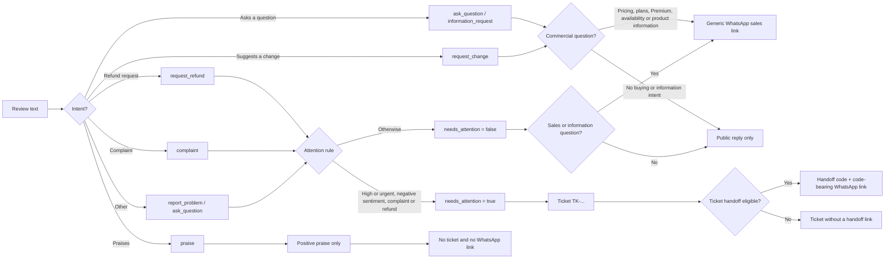

### Attention rules

```text
needs_attention = true when:
    priority is high or urgent
    OR sentiment is negative
    OR intent is complaint
    OR intent is refund request

A positive praise-only review cannot be escalated into a ticket.
The star rating is a co-input; it is never the classifier or link gate.
```

## 3. Which link is used?

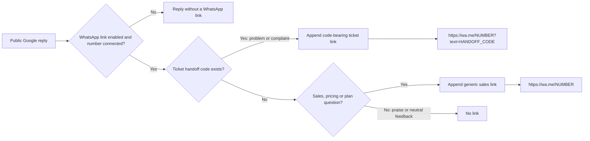

| Review situation | Ticket | Handoff code | WhatsApp behavior |
|---|---:|---:|---|
| Complaint, refund, unresolved service problem | Yes | Yes | Agent opens the ticket with full context |
| High-priority problem on a 5-star review | Yes | Yes | Agent opens the ticket with full context |
| “Great service, what does Premium cost?” | No | No | Normal WhatsApp sales conversation; becomes a lead |
| Product availability or plan information question | No | No | Normal WhatsApp sales conversation; becomes a lead |
| Praise only | No | No | Public reply only |
| Neutral feedback with no request | No | No | Public reply only |

## 4. Google reply publishing policy

Classification and link selection happen before the merchant publishing decision.

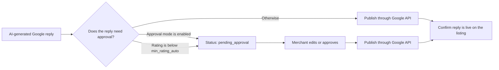

A queued reply contains the correct ticket or sales link, but the customer does
not see it until the merchant approves and it is published.

## 5. WhatsApp continuation: ticket path

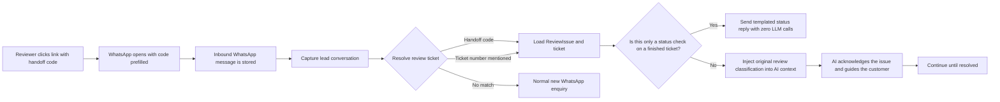

### Ticket lifecycle

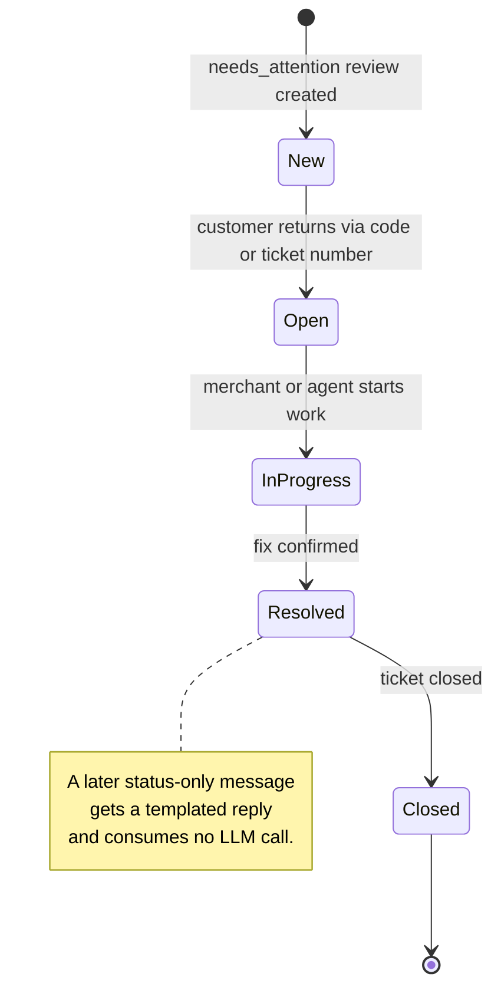

## 6. WhatsApp continuation: sales path

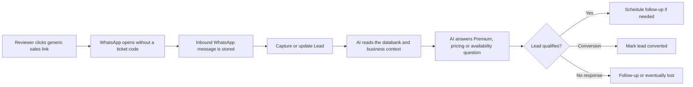

### Lead lifecycle

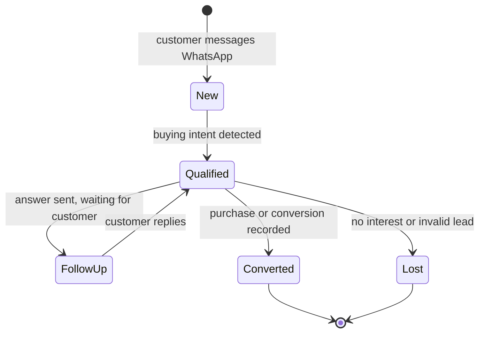

## 7. Ticket and lead are deliberately different

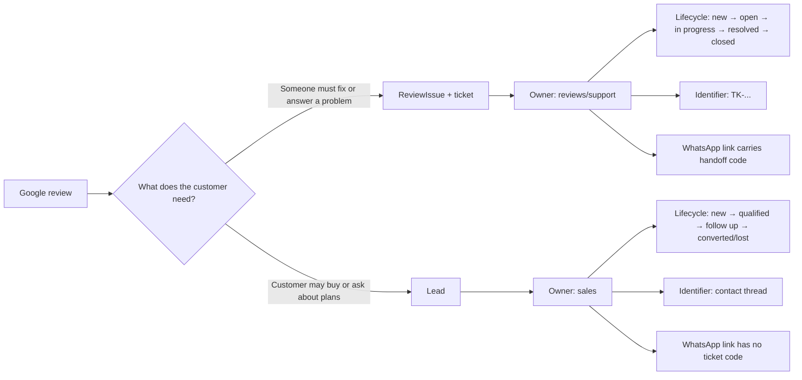

They may be linked operationally when a complaint later becomes a purchase
enquiry, but they are not merged: their owners, lifecycles, and identifiers are
different.

## 8. Live ticket updates and notifications

A ticket's life happens where nobody is watching: the poll loop classifies a
review and opens a ticket, and the customer walks back in on WhatsApp minutes
or hours later. Two channels, deliberately different.

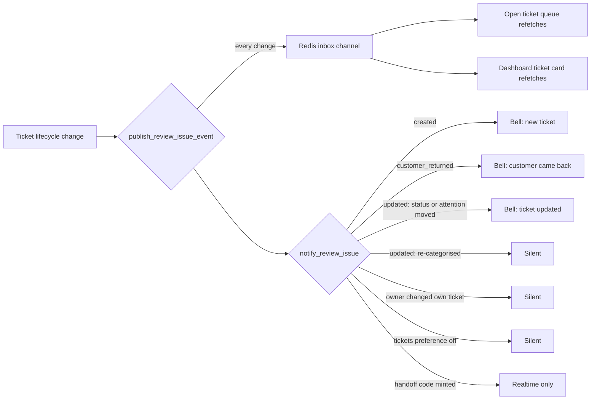

| Event | Realtime | Bell entry |
| --- | --- | --- |
| `created` — review needs attention, ticket opened | yes | yes |
| `handoff_minted` — customer got a code to quote | yes | no |
| `customer_returned` — customer messaged the code on WhatsApp | yes | yes |
| `updated` — ticket edited | yes | only when status or `needs_attention` moved |
| classified review with nothing to action (praise, question) | no | no |

Rules the implementation holds to:

- **Praise is never a ticket**, so it is never announced — otherwise merchants
  learn to ignore ticket alerts.
- **A handoff code is realtime-only.** It is minted seconds after the ticket is
  created, so a second bell entry would be the same news twice.
- **The owner never notifies themselves.** An employee editing a ticket does
  alert the workspace; the owner who clicked the button does not.
- **Events are published after the commit** (the customer-return path after the
  flush the caller owns), so a queue never redraws from a rolled-back change.
- **Publishes are best-effort.** Redis down costs a refresh; `notify()` writes
  in a savepoint, so a failed bell entry cannot roll back a review pipeline or a
  customer's reply.
- **The browser refetches on the event** rather than rendering the event
  payload — it carries the ticket's identity only, never the review text.
- **Event bursts are coalesced** (400 ms): one new ticket arrives as `created`
  plus `handoff_minted`, and a customer returning chains further updates.
- **The bell's 45 s poll stays** as the fallback for a dropped socket; realtime
  is the fast path, not the only path.

## 9. Safety and data boundaries

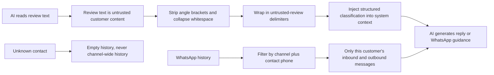

- Ticket and handoff codes are unique per tenant.
- Handoff codes use a 30-character alphabet with no ambiguous `0/O` or `1/I`.
- WhatsApp history is per conversation, never shared across customers.
- Synthetic dashboard tests never publish to Google or send a WhatsApp message.
- Ticket events and notifications are tenant-scoped, like the ticket itself.